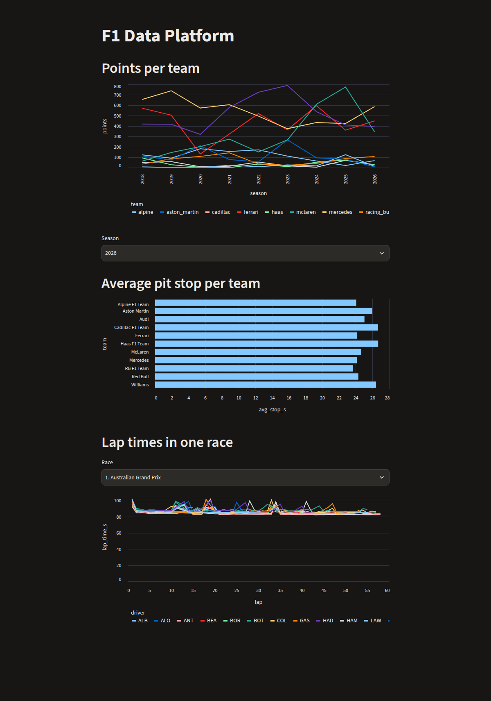
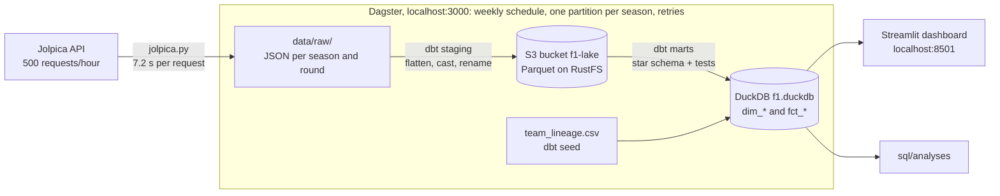

# F1 Data Platform

An end-to-end data platform for Formula 1 data, built as my first data engineering project. It downloads race results, pit stops and lap times from the [Jolpica API](https://github.com/jolpica/jolpica-f1), transforms them with dbt into a star schema, and shows the results in a dashboard. Everything runs locally with Docker.



## Why I built this

I wanted to learn data engineering by building a whole pipeline myself, from an API to a dashboard, instead of following separate tutorials. F1 data is a good fit: it is public, it has a clear structure (seasons, races, drivers, teams), and it has enough volume and quirks to run into real problems.

## Architecture



## What it does

- **Ingests** 9 seasons (2018–2026): 193 races, with results, pit stops and 212,650 lap times. Downloads are incremental, retried on failure, and throttled to stay within the API's rate limit.
- **Transforms** the raw JSON with dbt: staging models written as Parquet to S3-compatible storage, and a star schema in DuckDB (`dim_race`, `dim_driver`, `dim_constructor`, `fct_race_results`, `fct_pit_stops`, `fct_lap_times`).
- **Tests** the data with 29 dbt tests: unique keys, foreign keys, completeness of every season, and a lineage entry for every team.
- **Orchestrates** everything with Dagster: one partition per season, a weekly refresh of the current season, and the dbt models as assets in the same graph.
- **Shows** the results in a Streamlit dashboard: points per team over the seasons, average pit stops per team, and lap times per driver in one race.
- **Checks** every pull request in CI: linting, unit tests, and a full `dbt build` on a small set of real data.

## Tech stack

| Tool | Used for |
|---|---|
| Python, `requests` | Downloading from the API, with retries and throttling |
| dbt + DuckDB | Transformations, tests and the star schema |
| Parquet + RustFS (S3-compatible) | Storing the staging layer as open files in object storage |
| Dagster | Orchestration, partitions, schedules |
| Streamlit | The dashboard |
| Docker Compose | Running the storage, Dagster and the dashboard together |
| GitHub Actions, ruff, pytest | CI |

## Decisions and lessons learned

- **The API's rate limit broke my first full download.** Lap times need about 2,400 requests, and the API allows 500 per hour. Retries alone didn't help, because the limit is per hour. I added client-side throttling (one request every 7.2 seconds), so a full download now runs unattended in about 5 hours.
- **A chart exposed a data quality problem.** The average pit stop per team came out at up to 280 seconds. During a red flag, cars wait in the pit lane, and the API records that as a pit stop of up to 51 minutes. I flag those stops as `is_long_stop` in the fact table, so the dashboard and the analyses use the same rule.
- **Renamed teams are one team.** Toro Rosso, AlphaTauri and RB are three IDs in the API. A dbt seed maps each ID to its team lineage, and a test fails when a new team appears that is not in the seed yet.
- **Incremental where the volume is.** `fct_lap_times` holds over 200,000 rows, so it only adds new races instead of rebuilding everything.
- **MinIO stopped publishing free Docker images** while I was building the storage layer. I switched to RustFS, which speaks the same S3 API, so only the Docker image changed.
- **dbt in CI without the real data.** CI has no data and no S3, so it runs `dbt build` on one season of real data stored in `tests/fixtures/`, with a separate dbt target that writes Parquet locally.

## Quick start

You need Git, Python 3.12+ and Docker.

```bash
git clone https://github.com/LucDictus/f1-data-platform.git && cd f1-data-platform
```

```bash
cp .env.example .env
```

Fill in a username and password in `.env`, then:

```bash
docker compose up -d --build
```

Dagster runs on http://localhost:3000 and the dashboard on http://localhost:8501. The platform starts without data: see [docs/setup.md](docs/setup.md) for the full setup, including the first download.

## Documentation

- [docs/setup.md](docs/setup.md): installation, from a clean machine to a running platform with data
- [docs/usage.md](docs/usage.md): downloading, dbt, Dagster, the dashboard and development

## Project structure

```
src/f1_pipeline/       ingestion (ingest/jolpica.py) and the Dagster definitions
transform/             dbt project: staging, marts, seeds and tests
dashboard/             Streamlit app
sql/analyses/          ad-hoc SQL on the marts
tests/                 unit tests, and fixture data for dbt in CI
docker-compose.yml     storage, Dagster and the dashboard
```

## License

[MIT](LICENSE). The F1 data comes from the [Jolpica API](https://github.com/jolpica/jolpica-f1).
