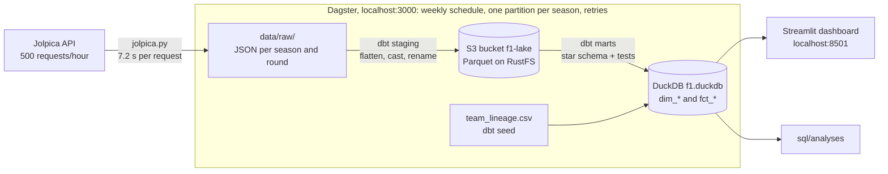

# F1 Data Platform

A learning project that downloads Formula 1 data from the [Jolpica API](https://api.jolpi.ca/ergast/f1), stores the raw JSON, and transforms it with SQL in DuckDB. The cleaned data is written as Parquet files to local S3-compatible object storage, which runs in Docker. Dagster orchestrates the pipeline, and a Streamlit dashboard shows the results.

## Architecture



## Installation

You need **Git**, **Python 3.12 or newer** and **Docker** (with Docker Compose). Everything else is installed into a virtual environment inside the project folder, or runs in a container.

### 1. Check the prerequisites

```bash
git --version
```

```bash
python3 --version
```

```bash
docker compose version
```

If Git or Python is missing on Ubuntu/Debian:

```bash
sudo apt install git python3 python3-venv
```

For Docker, follow the [official install guide](https://docs.docker.com/engine/install/).

### 2. Clone the repo

```bash
git clone https://github.com/LucDictus/f1-data-platform.git
```

```bash
cd f1-data-platform
```

### 3. Create and activate a virtual environment

A virtual environment (`.venv/`) keeps this project's packages separate from the rest of your system.

```bash
python3 -m venv .venv
```

```bash
source .venv/bin/activate
```

Your prompt now starts with `(.venv)`. **Run `source .venv/bin/activate` again every time you open a new terminal.**

### 4. Install the project

```bash
pip install -e ".[dev]"
```

This installs the pipeline packages (`requests`, `duckdb`, `dbt-duckdb`, `dagster`, `dagster-dbt` and `streamlit`) and the development tools (`pytest`, `ruff`, `responses` and `dagster-webserver`). `-e` means "editable": your code changes take effect without reinstalling.

### 5. Start the containers

The staging models are written as Parquet files to an S3 bucket. Locally that bucket lives in [RustFS](https://rustfs.com), an S3-compatible server that runs in Docker. It works the same way as AWS S3, so in the cloud only the address and the keys would change.

Create your own settings file from the example. Git ignores `.env`, so your keys never end up on GitHub:

```bash
cp .env.example .env
```

Open `.env` and fill in both values: a username and a password you make up. They are only used on your own machine. Then build and start everything:

```bash
docker compose up -d --build
```

This starts four containers:

| Container | What it does |
|---|---|
| `s3` | The storage server, on port 9000. Its data is kept in a Docker volume, so it survives a restart |
| `createbucket` | Creates the bucket `f1-lake`, then stops |
| `dagster` | The pipeline and its web interface, on http://localhost:3000. See [Orchestration](#orchestration-dagster) |
| `dashboard` | The Streamlit dashboard, on http://localhost:8501. See [Dashboard](#dashboard) |

`dagster` and `dashboard` use the same image, built from the `Dockerfile`, but each runs a different command. `--build` rebuilds that image, so your latest code changes are included. The first build takes about a minute.

Stop everything with `docker compose down`. Adding `-v` also deletes the stored Parquet files. Containers don't start again by themselves after your laptop restarts, so run `docker compose up -d` again.

### 6. Check that it works

```bash
pytest
```

All tests should pass.

## Usage

Run every command from the repo root, because the scripts use paths relative to it.

**Download the raw data** for one season, or a range of seasons (2018 up to the current season):

```bash
python src/f1_pipeline/ingest/jolpica.py --season 2024
```

```bash
python src/f1_pipeline/ingest/jolpica.py --from 2018 --to 2025
```

This downloads race results, and per race the pit stops and lap times. The API allows 500 requests per hour, so the script waits 7.2 seconds before every request. Lap times are large (about 12 requests per race), so a first full download of all seasons takes about 5 hours. You can stop it at any time: the next run skips what is already on disk.

Past seasons that are already on disk are skipped. The current season is always downloaded again, because races are still being added.

The JSON files are written to `data/raw/`. Git ignores this folder.

**Transform the data with dbt.** The dbt project lives in `transform/`. Staging is written as Parquet files to the `f1-lake` bucket, and the marts are built into the DuckDB database `data/f1.duckdb`:

| Folder | Schema | What it holds |
|---|---|---|
| `transform/models/staging/` | `staging` | One Parquet file per raw source, at `s3://f1-lake/staging/<model>.parquet`: flatten, cast and rename only. `_sources.yml` points to the raw JSON. DuckDB has a view on each file, so `ref()` works as usual |
| `transform/models/marts/` | `marts` | Star schema: `dim_*` tables (one row per thing) and `fct_*` tables (one row per event). The grain is the first line of each file. `_marts.yml` holds the single-column tests |
| `transform/seeds/` | `main` | Small hand-written CSV tables, loaded by `dbt build`. `team_lineage.csv` maps every `constructor_id` to its team across renames (for example Toro Rosso, AlphaTauri and RB are all `racing_bulls`). Add a row when a new team appears; a test fails until you do |
| `transform/tests/` | none | Tests on several columns. Each one returns the bad rows, so 0 rows means it passes |
| `sql/analyses/` | none | Ad-hoc queries that read from the marts |

dbt needs the storage keys from `.env`, and the storage must be running (`docker compose up -d`). Load the keys into your terminal; do this again in every new terminal:

```bash
set -a && source .env && set +a
```

**Build and test** everything in one command. Run it after every new download, or after changing a model. dbt works out the order from the `ref()` and `source()` calls:

```bash
dbt build --project-dir transform --profiles-dir transform
```

Every line should say `OK` or `PASS`. A failing test stops the models that depend on it.

`fct_lap_times` is **incremental**: after the first build, dbt only adds races that are not in the table yet. When you change its SQL, rebuild it from scratch:

```bash
dbt build --project-dir transform --profiles-dir transform --full-refresh
```

**Run an analysis**, for example:

```bash
python scripts/run_sql.py sql/analyses/06_constructor_pitstops.sql
```

The database and the Parquet files hold no data of their own, so you can delete them and rebuild them at any time. Do this after renaming or removing a model, so that stale views and tables can't hide mistakes:

```bash
rm data/f1.duckdb
```

```bash
dbt build --project-dir transform --profiles-dir transform
```

## Orchestration (Dagster)

Dagster runs the download and `dbt build` as one pipeline, in the right order. The pipeline is defined in `src/f1_pipeline/definitions.py`.

It runs in the `dagster` container, which `docker compose up -d --build` starts (see [step 5](#5-start-the-containers)). The container gets the keys from `.env`, and reaches the storage at `s3:9000`: inside Docker, containers find each other by service name, not via `localhost`. It reads and writes your local `data/` folder, so raw data, the database and Dagster's run history (`data/dagster_home/`) stay on your laptop. Follow its log with:

```bash
docker compose logs -f dagster
```

To run Dagster outside Docker instead (for example while changing `definitions.py`), stop the container first, because both use port 3000:

```bash
docker compose stop dagster
```

```bash
dagster dev -m f1_pipeline.definitions
```

Open http://localhost:3000:

- **Assets → View lineage** shows the whole graph, from the raw JSON to the marts.
- **Materialize all** runs the pipeline now: pick one or more seasons, Dagster downloads them, then builds and tests every dbt model. Each season is a partition: **Assets → jolpica/results** shows which seasons are loaded, and a missing season can be backfilled from there.
- **Automation → `weekly_schedule`** refreshes the current season every Monday at 06:00 (Amsterdam time). Schedules start switched off, so turn it on here. It only runs while Dagster is running.

To rebuild only the dbt models, without downloading, select the `staging/` and `marts/` assets and click **Materialize selected**. Never start a download in Dagster while the download script is running in a terminal: together they exceed the API limit of 500 requests per hour.

Failed downloads are retried 3 times, 30 seconds apart. The dbt test `season_completeness_dim_race` fails if a season from 2018 to now has no races.

## Dashboard

`dashboard/app.py` is a [Streamlit](https://streamlit.io) app that reads the marts from `data/f1.duckdb`. It shows:

- points per team per season, using `team_lineage`, so renamed teams stay one line
- the average pit stop per team, for the season you pick. Stops over 60 seconds (`is_long_stop` in `fct_pit_stops`: cars waiting in the pit lane during a red flag) are left out
- lap times per driver in one race. Laps slower than 1.2 × the race median (safety car, red flag) are left out, so the chart doesn't flatten

The `dashboard` container serves it on http://localhost:8501. To run it outside Docker instead (for example while changing `app.py`), stop the container first, because both use port 8501:

```bash
docker compose stop dashboard
```

```bash
streamlit run dashboard/app.py
```

The dashboard opens the database for each query and closes it straight away. DuckDB allows only one process to write to a database file, and while any connection is open, even a read-only one, `dbt build` fails with `Could not set lock on file`. Query results are cached for 10 minutes, so after a new `dbt build` the charts can take up to 10 minutes to update.

## Development

Run these before you push. CI runs the same checks on every pull request:

```bash
ruff check .
```

```bash
ruff format --check .
```

```bash
pytest
```

Run `ruff format .` to fix formatting automatically.
